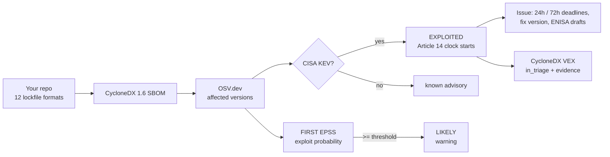

<div align="center">

# CRA Clock

### 24 hours starts the moment you know.

**The EU Cyber Resilience Act reporting clock, as a GitHub Action.** CRA Clock reads your lockfiles, writes a CycloneDX
SBOM, checks every component against OSV, CISA's Known Exploited Vulnerabilities catalog and FIRST EPSS, and the moment
something you ship is actively exploited it opens an issue with the Article 14 deadlines and pre-filled ENISA drafts.

[Website](https://craclock.gautamkhosla.com) · [Install](#install) · [What it does](#what-it-does) · [Outputs](#outputs) · [Security](SECURITY.md) · [CRA primer](docs/CRA.md)

</div>

---

## Why

Since **11 September 2026**, manufacturers of products with digital elements sold in the EU must report every **actively
exploited vulnerability** through the ENISA Single Reporting Platform:

| When | What |
|---|---|
| **24 hours** after becoming aware | Early warning: exploited, which product, which Member States |
| **72 hours** | Notification: severity, corrective and mitigating measures |
| **14 days** after a fix is available | Final report |

This applies to products already on the market, and the full CRA obligations (including SBOMs) follow in December 2027.
Large vendors have PSIRTs. Most small software and IoT companies find out a dependency is being exploited from a customer,
long after the 24 hours started. ([STAR](https://star.global/posts/cyber-resilience-act-article-14-reporting-requirements/), [HackerOne](https://www.hackerone.com/blog/eu-cra-reporting-requirements))

## Install

```yaml
# .github/workflows/cra-clock.yml
name: cra-clock
on:
  push: { branches: [main] }
  schedule: [{ cron: '17 */6 * * *' }]     # KEV changes daily; check every 6 hours
permissions: { contents: read, issues: write }
jobs:
  clock:
    runs-on: ubuntu-latest
    steps:
      - uses: actions/checkout@v5
      - uses: GautamTalksDev/cra-clock@v1
        with:
          product-name: Acme Router
      - uses: actions/upload-artifact@v4
        with: { name: cra-clock, path: cra-clock/ }
```

## What it does



- **Lockfiles**: `package-lock.json`, `npm-shrinkwrap.json`, `yarn.lock`, `pnpm-lock.yaml`, `requirements.txt` (pinned),
  `poetry.lock`, `Pipfile.lock`, `go.mod`, `Cargo.lock`, `Gemfile.lock`, `composer.lock`, `gradle.lockfile`.
- **Signal, not noise**: only CISA KEV evidence (reliable evidence of exploitation in the wild) starts the clock. High EPSS
  is a warning. Everything else is listed in the report.
- **The clock never resets**: the first detection time is stored in the issue, so re-runs update the countdown instead of
  restarting it. Close the issue when the final report is filed.
- **De-duplicated**: one finding per component and CVE, however many advisory ids describe it.

## Outputs

| File | What |
|---|---|
| `cra-clock/sbom.cdx.json` | CycloneDX 1.6 SBOM with purls and the files each component came from |
| `cra-clock/vex.cdx.json` | CycloneDX 1.6 VEX: each vulnerability, affected components, KEV and EPSS evidence |
| `cra-clock/report.md` | The job summary (also written to the GitHub step summary) |
| Issues labelled `cra-clock` | One per actively exploited vulnerability, with deadlines and drafts |

Step outputs: `components`, `exploited`, `likely`, `sbom`, `vex`.

## Inputs

| Input | Default | |
|---|---|---|
| `product-name` | repo name | Used in reports and drafts |
| `product-version` | ref name | Recorded in the SBOM |
| `open-issues` | `true` | Open and update Article 14 issues |
| `fail-on` | `exploited` | `exploited`, `likely`, or `never` |
| `epss-threshold` | `0.1` | EPSS at or above this is "likely" |
| `output-dir` | `cra-clock` | Where files are written |

## Try it without installing

The website scans a lockfile in your browser with the same parsers and tiers. Click "Try a vulnerable demo project" to see a
Java service still shipping Log4Shell and Spring4Shell light up.

## Develop

```bash
node --test test/*.test.mjs     # parsers for every format, the clock, untrusted-text handling, end to end
node site/dev.mjs 8792          # the website, with a live KEV mirror
```

## Not legal advice

CRA Clock prepares drafts and evidence; it does not submit anything to ENISA. Check whether your product is in scope.
CISA KEV is one reliable source of exploitation evidence; if you learn of exploitation another way, the clock started then.

## License

Apache-2.0.
