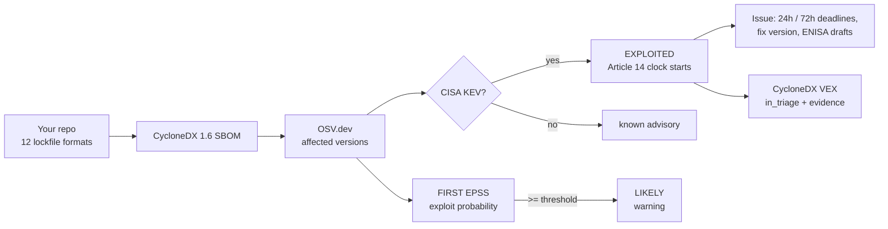

<div align="center">

# CRA Clock

### 24 hours starts the moment you know.

**The EU Cyber Resilience Act reporting clock, as a GitHub Action.** CRA Clock reads your lockfiles, writes a CycloneDX
SBOM, checks every component against OSV, CISA's Known Exploited Vulnerabilities catalog and FIRST EPSS, and the moment
something you ship is actively exploited it opens an issue with the Article 14 deadlines and pre-filled ENISA drafts.

[Website](https://craclock.gautamkhosla.com) · [Install](#install) · [What it does](#what-it-does) · [Outputs](#outputs) · [Security](SECURITY.md) · [CRA primer](docs/CRA.md)

</div>

---

## Why

From **11 September 2026**, Article 14 of the EU Cyber Resilience Act requires manufacturers of products with digital
elements made available in the EU to report **actively exploited vulnerabilities** (and severe incidents) through the
single reporting platform set up under the CRA. For an actively exploited vulnerability:

| When | What |
|---|---|
| **24 hours** after becoming aware | Early warning: exploited, which product, which Member States |
| **72 hours** | Notification: nature of the exploit and the vulnerability, corrective and mitigating measures |
| **14 days** after a corrective or mitigating measure is available | Final report |

This applies to products already on the market; the rest of the CRA (including the SBOM obligation) applies from
11 December 2027. Large vendors have PSIRTs. Smaller teams without anyone watching their dependencies can learn about
an exploited component late, for example from a customer report, while the 24 hours may already be running from the
moment they could have known. CRA Clock covers actively exploited vulnerabilities in your
dependencies; severe incidents are outside its scope.

Primary sources: [Regulation (EU) 2024/2847 on EUR-Lex](https://eur-lex.europa.eu/eli/reg/2024/2847/oj) (Article 14,
reporting; Article 71, dates of application) and the European Commission's
[CRA reporting obligations page](https://digital-strategy.ec.europa.eu/en/policies/cra-reporting).

## Install

The GitHub Marketplace listing goes live with v1.0.0. Until then, reference the Action by repository as shown below.

```yaml
# .github/workflows/cra-clock.yml
name: cra-clock
on:
  push: { branches: [main] }
  schedule: [{ cron: '17 */6 * * *' }]     # KEV changes daily; check every 6 hours
permissions: { contents: read, issues: write }
jobs:
  clock:
    runs-on: ubuntu-latest
    steps:
      - uses: actions/checkout@v5
        with: { persist-credentials: false }
      - uses: GautamTalksDev/cra-clock@v1
        with:
          product-name: Acme Router
          open-issues: ${{ github.event_name != 'pull_request' }}
      - uses: actions/upload-artifact@v4
        if: ${{ !cancelled() }}                  # keep the SBOM and VEX when the clock fails the job
        with: { name: cra-clock, path: cra-clock/ }
```

**Pin by commit SHA (recommended).** Tags can move; a full commit SHA cannot. Pin a release's SHA and let Dependabot
update it:

```yaml
      - uses: GautamTalksDev/cra-clock@<full-40-character-commit-sha> # v1.0.0
```

**Pull requests from forks.** GitHub gives fork pull requests a read-only token, so issues cannot be opened. If issue
creation returns 403, CRA Clock falls back to the job summary with a note instead of failing. Set `open-issues: false`
for `pull_request` events (as above) and let the push and schedule runs open the issues.

## What it does



- **Lockfiles**: `package-lock.json`, `npm-shrinkwrap.json`, `yarn.lock`, `pnpm-lock.yaml`, `requirements.txt` (pinned),
  `poetry.lock`, `Pipfile.lock`, `go.mod`, `Cargo.lock`, `Gemfile.lock`, `composer.lock`, `gradle.lockfile`.
- **Signal, not noise**: only CISA KEV evidence (reliable evidence of exploitation in the wild) starts the clock. High EPSS
  is a warning. Everything else is counted in the report and listed in the VEX.
- **The clock never resets**: the first detection time is stored in the issue, so re-runs update the countdown instead of
  restarting it. Close the issue when the final report is filed.
- **De-duplicated**: one finding per component and CVE, however many advisory ids describe it.
- **Never silently clean**: if OSV advisory details or EPSS scores cannot be fetched, the advisory is marked
  `intel-incomplete`, listed in the job summary for manual review, and the job fails unless `allow-incomplete-intel: true`.
- **Symlinks are never followed**: symlinked files and directories in the repo are skipped.

## Outputs

| File | What |
|---|---|
| `cra-clock/sbom.cdx.json` | CycloneDX 1.6 SBOM with purls and the files each component came from |
| `cra-clock/vex.cdx.json` | CycloneDX 1.6 VEX: each vulnerability, affected components, KEV and EPSS evidence |
| `cra-clock/report.md` | The job summary (also written to the GitHub step summary) |
| Issues labelled `cra-clock` | One per actively exploited vulnerability, with deadlines and drafts |

Step outputs: `components`, `exploited`, `likely`, `intel-incomplete`, `sbom`, `vex`.

## Inputs

| Input | Default | |
|---|---|---|
| `product-name` | repo name | Used in reports and drafts |
| `product-version` | ref name | Recorded in the SBOM |
| `open-issues` | `true` | `true` or `false`. Open and update Article 14 issues. Use `false` on `pull_request` |
| `fail-on` | `exploited` | `exploited`, `likely`, or `never`. Anything else is an error |
| `epss-threshold` | `0.1` | A number from 0 to 1; EPSS at or above this is "likely". `0` is allowed. Anything else is an error |
| `allow-incomplete-intel` | `false` | `true` lets the job pass when some advisories could not be fully checked (they are still listed) |
| `output-dir` | `cra-clock` | Where files are written |

Exit codes: `0` clean, `1` a `fail-on` condition or incomplete intelligence, `2` invalid input or an outage
(for example, the CISA KEV catalog could not be downloaded).

## Try it without installing

The [website](https://craclock.gautamkhosla.com) scans a lockfile in your browser with the same parsers and tiers. The
lockfile never leaves your browser: only package names and versions are sent to OSV.dev, and only CVE ids to FIRST.
Click "Try a vulnerable demo project" to see a Java service still shipping Log4Shell (disclosed December 2021) light up.

## Develop

```bash
node --test test/*.test.mjs     # parsers for every format, the clock, untrusted-text handling, end to end
node site/dev.mjs 8792          # the website, with a live KEV mirror
```

## Not legal advice

CRA Clock prepares drafts and evidence; it does not submit anything for you. Check whether your product is in scope.
CISA KEV is one reliable source of exploitation evidence; if you learn of exploitation another way, the clock started then.

## License

Apache-2.0.
